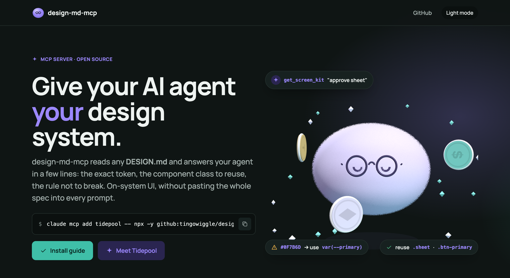
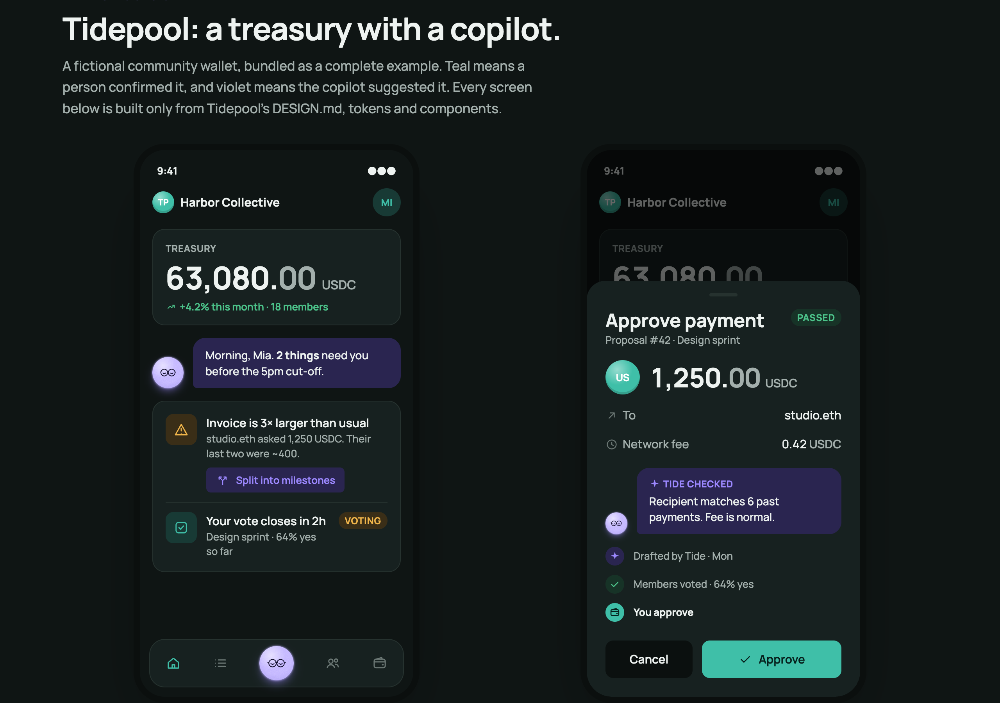

<div align="center">


# design-md-mcp

**Give your AI agent your design system.**

An MCP server that reads any `DESIGN.md` and answers your agent in a few lines:
the exact token, the component class to reuse, the rule not to break.

</div>



## Why

When an agent builds UI, it either guesses your colours or reads your whole design system on every
prompt. design-md-mcp sits in between: the agent asks a small question and gets a short answer,
a couple of lines for a colour or about a page of text to set up a whole screen, with the light and
dark values, the CSS variable to use and the component class that already exists.

- **On-system output.** Exact tokens, not "close enough" hex codes.
- **Reuse over rebuild.** It points the agent at your existing component classes, with a markup example.
- **Catches drift.** `check_value` flags made-up colours and pixel sizes and suggests the nearest token.
- **Works with any DESIGN.md.** Bring your own, or try the bundled Tidepool demo.

## Quick start

Needs Node 18+. Works with any MCP client: Claude Code, Cursor, Windsurf, Claude Desktop, VS Code.

### Try the Tidepool style

```bash
# 1. Copy the demo design system into ./tidepool
npx -y github:tingowiggle/design-md-mcp init tidepool

# 2. Connect it (Claude Code)
claude mcp add tidepool -- npx -y github:tingowiggle/design-md-mcp --file ./tidepool/DESIGN.md
```

Then ask your agent: *"Build a proposal voting screen in the Tidepool style, light and dark. Start with get_screen_kit."*

Just exploring? Skip the copy step: `--example tidepool` uses the bundled files directly.

### Use your own DESIGN.md

```bash
claude mcp add my-design -- npx -y github:tingowiggle/design-md-mcp --file ./DESIGN.md
```

<details>
<summary>Cursor, Windsurf and other clients (JSON config)</summary>

```json
{
  "mcpServers": {
    "my-design": {
      "command": "npx",
      "args": ["-y", "github:tingowiggle/design-md-mcp",
               "--file", "./DESIGN.md",
               "--css", "./src/styles/tokens.css"]
    }
  }
}
```

Add it to your client's MCP config (e.g. `.cursor/mcp.json`) and restart the client.
</details>

### Options

| Flag | What it does |
|---|---|
| `--file <path>` | Your `DESIGN.md` (required, unless `--example`) |
| `--css <path>` | Stylesheet(s) with your CSS variables and component classes. `tokens.css` next to `DESIGN.md` is picked up automatically |
| `--examples <path>` | HTML that uses your components, for markup examples. `showcase.html` next to `DESIGN.md` is picked up automatically |
| `--docs <path>` | Extra markdown files with rules |
| `--scope <selector>` | Where your tokens live if not `:root` (e.g. `.app`). Detected automatically |
| `--example tidepool` | Use the bundled demo |
| `init tidepool [dir]` | Copy the demo into your project |

## Tools

| Tool | Ask it | Answer size |
|---|---|---|
| `get_screen_kit` | "approve payment sheet". **Start here**: setup, every reusable class, the most relevant components with markup, and the must-follow rules | about a page (~650 tokens) |
| `get_component` | "bottom-sheet" → use `.sheet`, plus markup, spec and rules | a short paragraph (~170 tokens) |
| `get_token` | "primary" → `var(--primary)`, light and dark values, where to use it | 2–3 lines (~80 tokens) |
| `find_token` | "rejected status" → the right tokens or components | 2–3 lines (~90 tokens) |
| `check_value` | "#0F7B6D" → not a token, use `var(--primary)` | 2–3 lines (~55 tokens) |
| `get_rules` | "colour rules" → that section of your DESIGN.md | a short paragraph (~120 tokens) |
| `ds_overview` | every token and component name, no values | half a page (~420 tokens) |

Loading the tools adds ~800 tokens to your agent's context. For comparison, reading Tidepool's full
`DESIGN.md` and stylesheet is ~6,300 tokens.

## What goes in a DESIGN.md

YAML tokens between `---` fences, then markdown sections with your rules:

```markdown
---
name: My Product
colors:
  primary: "#0F7B6C"
  ink: "#10221F"
rounded:
  md: 10px
components:
  button-primary:
    backgroundColor: "{colors.primary}"
    rounded: "{rounded.md}"
---

## Colors
| Token | Light | Dark | Use |
|---|---|---|---|
| `--primary` | `#0F7B6C` | `#3FBFA8` | The confirm action |

## Components
### Primary button
`.btn .btn-primary`. One per view.

## Do's and Don'ts
| Do | Don't |
|---|---|
| One primary button per view | Two primary buttons side by side |
```

The server links YAML names to CSS variables that share a value, maps component names to your
stylesheet's classes (`button-primary` → `.btn-primary`, `bottom-sheet` → `.sheet`), and indexes every
section so `get_rules` can answer by topic. A `## Setup` section travels with `get_screen_kit`.

## Tidepool, the demo design system

A fictional community wallet with an AI copilot, Tide, bundled as a complete example in
[`examples/tidepool`](examples/tidepool). Teal means a person confirmed it; violet means the copilot
suggested it.



| File | What it is |
|---|---|
| `DESIGN.md` | Tokens, components and rules |
| `tokens.css` | CSS variables (light + dark) and component classes |
| `icons.js` | 14-icon line set as an inline sprite |
| `tide.js` | Tide in 3D (three.js): `mountTide(canvas)` |

Open [`index.html`](index.html) for the full showcase page.

## Develop

```bash
npm install
node src/smoke.js                          # calls every tool against Tidepool
node src/cli.js get_token '{"name":"primary"}' -- --example tidepool
```

## License

Apache-2.0 · made by Web3 Story Lab. Tidepool and all its names and data are fictional.
